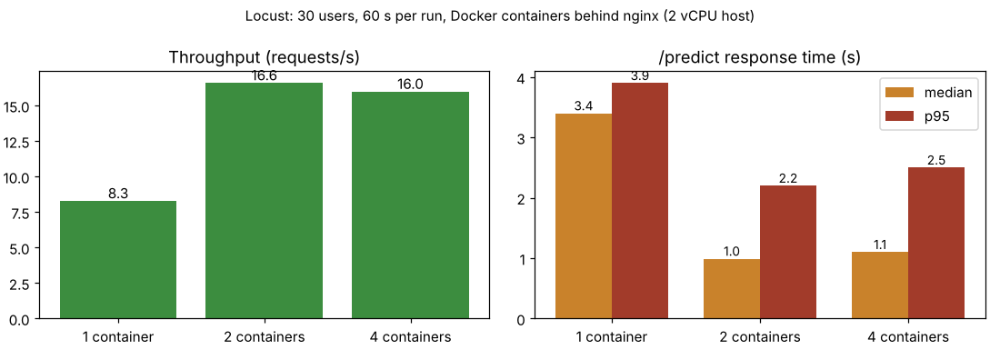

# Bean Watch: bean leaf disease classifier

Classifies a photo of a bean leaf as **healthy**, **angular leaf spot** or **bean rust**, and covers the full ML cycle: data, preprocessing, training, evaluation, an API, a web UI, uploading new data, retraining, Docker deployment and load testing.

- **Video demo:** TODO
- **Live app:** TODO (API docs at `/docs`)

## Project

Beans are a staple crop and a key protein source for smallholder farmers in Rwanda. Angular leaf spot and bean rust can destroy much of a harvest if they are not caught early. This app lets a farmer check a leaf from a phone photo.

**Dataset:** [iBean](https://github.com/AI-Lab-Makerere/ibean) (Makerere AI Lab), field photos of bean leaves in three balanced classes.

| Folder | Content | Images |
|---|---|---|
| `data/train/` | iBean train + validation splits (15% used for validation) | 1,122 |
| `data/test/` | iBean test split, only used for evaluation | 128 |
| `sample_images/retrain/` | held-out images to demo upload + retraining | 45 |
| `sample_images/predict/` | test images to demo prediction | 6 |

**Model:** MobileNetV2 (ImageNet) + a small dense head, trained in two stages: head only, then fine-tuning the top 60 layers. Uses dropout, L2, Adam, early stopping, learning-rate reduction and data augmentation.

## Results

On the 128 test images:

| Metric | Frozen base | Fine-tuned (served) |
|---|---|---|
| Accuracy | 91.4% | **94.5%** |
| Loss | 0.234 | **0.099** |
| Precision (macro) | 0.917 | **0.945** |
| Recall (macro) | 0.915 | **0.946** |
| F1 (macro) | 0.914 | **0.945** |

ROC-AUC is above 0.99 for every class. Most remaining errors involve bean rust; only 2 of 86 diseased leaves were called healthy.

Retraining runs from the served model and only replaces it if test F1 does not drop (notebook section 8, and the Retrain tab in the app).

**Data insights** (Data insights tab and notebook section 2):
1. **Class balance:** 370-378 images per class, so accuracy is a fair metric.
2. **Brightness:** almost the same for all classes, so lighting is not a shortcut.
3. **Green fraction:** about 72% of a healthy photo is green vs about 45% for diseased leaves.
4. **Lesion-coloured fraction:** diseased leaves have about twice the brown/yellow area.
5. **Edge density:** does not separate the classes; edges come mostly from veins and backgrounds.

Colour separates healthy from diseased leaves, but not the two diseases from each other. Those differ in lesion shape, which a CNN can learn, and that is where the remaining errors are.

## How it works

1. **Data acquisition:** `src/preprocessing.py` (`download_ibean`, `list_images`)
2. **Preprocessing:** resize to 224x224, scale to [0, 1], augment training images
3. **Model:** `src/model.py` (`build_model`, `train_model`, `fine_tune_model`)
4. **Testing:** `evaluate_model` gives accuracy, loss, precision, recall, F1 and the confusion matrix
5. **Prediction:** `src/prediction.py` (`predict_image`)
6. **Retraining:** `api/retrain_job.py`
   - loads the uploaded images from the SQLite database
   - preprocesses them and adds 30 original images per class
   - continues training **our saved model**
   - compares old and new model on the test set and keeps the new one only if its F1 is not lower
   - **triggers:** the *Retrain now* button, or automatically when 30 new images are waiting
7. **API:** `api/main.py` (FastAPI)

## Repository structure

```
Beanleaf_disease_pipeline/
├── README.md
├── notebook/bean_disease_classifier.ipynb
├── src/
│   ├── preprocessing.py
│   ├── model.py
│   └── prediction.py
├── data/
│   ├── train/
│   └── test/
├── models/
│   ├── bean_model.h5
│   └── metrics.json
├── api/
│   ├── main.py
│   ├── database.py
│   └── retrain_job.py
├── ui/                      web UI and plots from the notebook
├── locust/                  load test, scaling script and results
├── sample_images/
├── Dockerfile
├── docker-compose.yml
├── nginx.conf
└── render.yaml
```

## Setup

### Run locally

```bash
git clone https://github.com/Keaane/Beanleaf_disease_pipeline.git
cd Beanleaf_disease_pipeline
python -m venv .venv
source .venv/bin/activate        # Windows: .venv\Scripts\activate
pip install -r requirements.txt

cd api
uvicorn main:app --port 8000
```

Open http://localhost:8000 for the UI and http://localhost:8000/docs for the API.

### Notebook

```bash
jupyter notebook notebook/bean_disease_classifier.ipynb
```

Run all cells (about 15-20 minutes on a CPU). On Google Colab the first cell clones the repo for you.

### Docker

```bash
docker build -t bean-watch .
docker run -p 8000:8000 bean-watch
```

### Several containers with a load balancer

```bash
docker compose up --build --scale api=2
```

Open http://localhost:8080. nginx spreads requests over the containers (the UI header shows which one answered). They share `models/` and the database in `state/`.

### Deploy on Render

1. On [Render](https://dashboard.render.com): **New** → **Blueprint** → choose this repo. It reads `render.yaml`.
2. Wait for the build, then open the URL.

The free plan has 512 MB RAM, sleeps after 15 idle minutes, and loses uploads and retrained models on restart.

## API

| Method | Path | Description |
|---|---|---|
| GET | `/health` | Liveness check |
| GET | `/status` | Uptime, model info, prediction stats, retrain state |
| POST | `/predict` | `file`: one image → class and probabilities |
| POST | `/upload-data/{class_name}` | `files`: several images, saved to the database |
| GET | `/uploads` | Recent uploads |
| POST | `/retrain` | Start retraining in the background |
| GET | `/retrain/status` | Progress log of the latest job |
| GET | `/retrain/history` | Past jobs: old vs new accuracy / F1, promoted or not |
| POST | `/evaluate` | Evaluate the live model on the test set |
| GET | `/visualizations/class-distribution` | Images per class |
| GET | `/visualizations/features` | Feature summary from the notebook |

## Demo steps

1. **Predict:** choose an image from `sample_images/predict/` → class, confidence and probabilities.
2. **Upload & retrain:** pick a class, select the images in `sample_images/retrain/<class>/`, upload, then press **Retrain now** and follow the log.
3. **Evaluate:** compare the metrics before and after retraining.
4. **Monitor:** uptime, model version, predictions served, inference time.

## Flood request simulation (Locust)

30 simulated users for 60 seconds, mostly calling `/predict`, against 1, 2 and 4 Docker containers behind nginx (2-vCPU Linux host, 1 CPU per container):

| Containers | Requests | Failures | Requests/s | /predict median | /predict p95 | /predict p99 |
|---|---|---|---|---|---|---|
| 1 | 488 | 0 | 8.3 | 3,400 ms | 3,900 ms | 4,100 ms |
| 2 | 978 | 0 | 16.6 | 990 ms | 2,200 ms | 2,500 ms |
| 4 | 943 | 0 | 16.0 | 1,100 ms | 2,500 ms | 3,000 ms |



- **1 → 2 containers:** throughput doubled and the median response time dropped from 3.4 s to 1.0 s.
- **4 containers:** no further gain, because the host has only 2 CPU cores. More containers only help when there are free cores.
- A single request with no load takes about 190 ms.

Reproduce (needs Docker and `pip install locust`):

```bash
USERS=30 DURATION=60s ./locust/run_scaling_test.sh
```

Raw CSVs and `summary.md` are in `locust/results/`.
